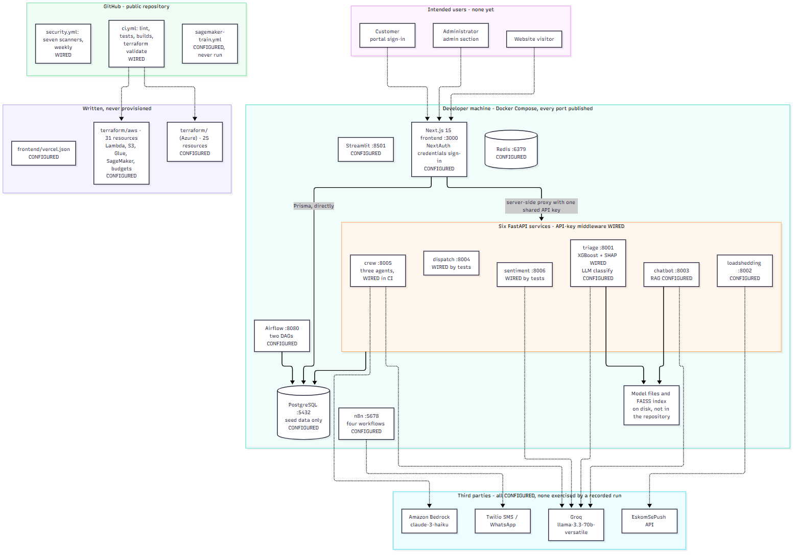

# As built — what exists today

Written 9 October 2026 from the code at commit `e99de3f`. Read-only: nothing in the
application, its configuration or its infrastructure was changed to produce it.

**Evidence tags**

| Tag | Meaning |
|---|---|
| WIRED | Called by running code and exercised: a test, a deployed path, or a recorded run |
| CONFIGURED | Present in config, IaC or dependencies, but not exercised end to end |
| DOCS ONLY | Mentioned in a document, with no code behind it |

**The one fact that frames everything else: this platform has never been deployed.**
`README.md:9` says so, the repository has no deployment record, and no cloud resource has
been created. It runs on a developer's machine under Docker Compose. Every cloud component
below is a description, not a system.

## 1. What runs, and where

```mermaid
flowchart TB
  subgraph users["Intended users - none yet"]
    visitor["Website visitor"]
    cust["Customer<br/>portal sign-in"]
    adm["Administrator<br/>admin section"]
  end

  subgraph local["Developer machine - Docker Compose, every port published"]
    web["Next.js 15 frontend :3000<br/>NextAuth credentials sign-in<br/>CONFIGURED"]
    subgraph svc["Six FastAPI services - API-key middleware WIRED"]
      triage["triage :8001<br/>XGBoost + SHAP WIRED<br/>LLM classify CONFIGURED"]
      load["loadshedding :8002<br/>CONFIGURED"]
      chat["chatbot :8003<br/>RAG CONFIGURED"]
      disp["dispatch :8004<br/>WIRED by tests"]
      crew["crew :8005<br/>three agents, WIRED in CI"]
      sent["sentiment :8006<br/>WIRED by tests"]
    end
    pg[("PostgreSQL :5432<br/>seed data only<br/>CONFIGURED")]
    redis[("Redis :6379<br/>CONFIGURED")]
    airflow["Airflow :8080<br/>two DAGs CONFIGURED"]
    n8n["n8n :5678<br/>four workflows CONFIGURED"]
    st["Streamlit :8501<br/>CONFIGURED"]
    files["Model files and FAISS index<br/>on disk, not in the repository"]
  end

  subgraph ext["Third parties - all CONFIGURED, none exercised by a recorded run"]
    groq["Groq<br/>llama-3.3-70b-versatile"]
    bedrock["Amazon Bedrock<br/>claude-3-haiku"]
    esp["EskomSePush API"]
    twilio["Twilio SMS / WhatsApp"]
  end

  subgraph gh["GitHub - public repository"]
    ci["ci.yml: lint, tests, builds,<br/>terraform validate<br/>WIRED"]
    sec["security.yml: seven scanners,<br/>weekly<br/>WIRED"]
    sm["sagemaker-train.yml<br/>CONFIGURED, never run"]
  end

  subgraph paper["Written, never provisioned"]
    tfaws["terraform/aws - 31 resources<br/>Lambda, S3, Glue, SageMaker, budgets<br/>CONFIGURED"]
    tfaz["terraform/ (Azure) - 25 resources<br/>CONFIGURED"]
    vercel["frontend/vercel.json<br/>CONFIGURED"]
  end

  visitor -.-> web
  cust -.-> web
  adm -.-> web
  web -- "server-side proxy with one shared API key" --> svc
  web -- "Prisma, directly" --> pg
  svc --> pg
  triage --> files
  chat --> files
  airflow --> pg
  triage -.-> groq
  chat -.-> groq
  sent -.-> groq
  crew -.-> groq
  crew -.-> bedrock
  load -.-> esp
  n8n -.-> twilio
  ci -.-> tfaws
  ci -.-> tfaz
```

Diagram source (Mermaid) - edit this, then run <code>render-diagrams.sh</code>

Solid arrows are code paths that run locally. Dotted arrows are paths that exist in code
and have no recorded run against the real service, or users who do not exist yet.

## 2. Components and evidence

| Component | Tag | Evidence |
|---|---|---|
| Six FastAPI services, 18 routes | WIRED | `services/*/main.py`; 49 tests passed, 8 skipped (run 2026-10-09) |
| API-key middleware, fail-closed outside development | WIRED | `security/auth/api_key_middleware.py`; `tests/test_api_key_env_gate.py` |
| JWT middleware | CONFIGURED, used by no service | `security/auth/jwt_middleware.py` |
| Next.js frontend, 18 pages and 17 API routes | CONFIGURED | `frontend/src/app/`; builds in CI; no frontend tests |
| NextAuth sign-in | CONFIGURED | `frontend/src/auth.ts`, `frontend/src/auth.config.ts`; layouts check the session |
| Frontend API routes | CONFIGURED, **16 of 17 without a session check** | `frontend/src/app/api/`; no `middleware.ts` |
| PostgreSQL through Prisma, 18 models | CONFIGURED | `packages/db/prisma/schema.prisma` |
| Quote estimator (XGBoost) with SHAP | WIRED, trained on synthetic data | `services/triage/train_model.py`; `services/triage/model/metrics.json` |
| LLM calls (Groq) | CONFIGURED | `services/triage/main.py`, `services/chatbot/main.py`, `services/sentiment/main.py` |
| Three-agent crew (CrewAI) | WIRED in CI, model output not recorded | `services/crew/agents.py`; CI job `test-crew` |
| Bedrock backend | CONFIGURED | `services/crew/agents.py`; `services/crew/benchmark_bedrock.py` |
| Retrieval (FAISS through LangChain, all-MiniLM-L6-v2) | CONFIGURED; index and source documents untracked | `services/chatbot/main.py` |
| ETL and Airflow | CONFIGURED | `etl/dags/rams_elec_etl_dag.py`, `etl/dags/followup_trigger_dag.py` |
| n8n workflows | CONFIGURED | `n8n/workflows/` (four files) |
| Lambda handlers | WIRED by tests, not deployed | `lambda/followup_trigger/handler.py`; `tests/test_followup_lambda.py` |
| AWS Terraform, 31 resources | CONFIGURED | `terraform/aws/`; CI job `terraform-aws` |
| Azure Terraform, 25 resources | CONFIGURED | `terraform/main.tf`, `terraform/security.tf`; CI job `terraform-azure` |
| CI security scanning | WIRED | `.github/workflows/security.yml`: Bandit, Safety, pip-audit, npm audit, detect-secrets, TruffleHog, Trivy |
| SageMaker training workflow | CONFIGURED, never run | `.github/workflows/sagemaker-train.yml` |
| Backups, monitoring, alerting | absent | nothing in the repository |
| Threat model, OWASP assessment, audit report | DOCS ONLY | `reports/threat_model.md`, `reports/owasp_assessment.md`, `reports/security_audit_report.md` |

## 3. Trust boundaries and exposure

Nothing is exposed to the internet, because nothing is hosted. What follows is what
**would** be exposed if the stack were put online as it stands:

| Would be reachable | Protection today | Evidence |
|---|---|---|
| Every service port, the database, Redis, Airflow, n8n and Streamlit | None at the network level: all twelve are published on every interface | `docker-compose.yml` |
| The six services' routes | A shared API key; health routes are open | `security/auth/api_key_middleware.py` |
| Frontend pages under the portal and admin sections | Session check in the layouts | `frontend/src/app/(portal)/layout.tsx`, `frontend/src/app/admin/layout.tsx` |
| Frontend API routes, including seven that read the database for analytics | **No session check** | `frontend/src/app/api/analytics/` |
| The three development API keys | Committed on purpose; refused when `APP_ENV` is not `development` | `security/auth/api_key_middleware.py` |

## 4. Live versus local

- **Live:** nothing.
- **Local:** the whole stack, the trained model files, the retrieval index, MLflow runs.
- **In CI only:** tests, builds, scans and Terraform validation.

## What could not be verified

1. **Whether the LLM paths work against the provider today.** No test or results file
   records a real model response. The model name in code is `llama-3.3-70b-versatile`; the
   career brief in the parent folder says that model was retired. Not checked here.
2. **Whether retrieval works.** The index and the documents it was built from are not in
   the repository, and no test exercises a query.
3. **Whether the Terraform would apply.** `terraform validate` checks types, not that a
   provider would accept the plan.
4. **The Bedrock and SageMaker paths.** No recorded run of either.
5. **The n8n workflows.** JSON files exist; nothing shows they have been imported or run.
6. **Whether the frontend's sign-in works end to end.** There are no frontend tests.
