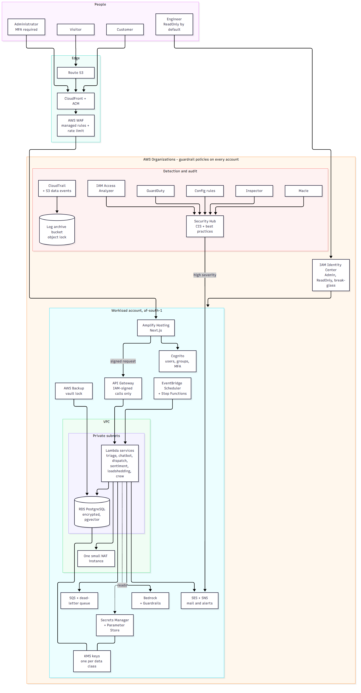
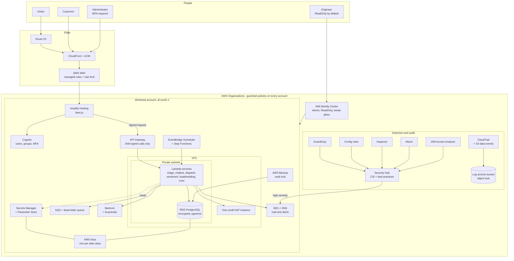
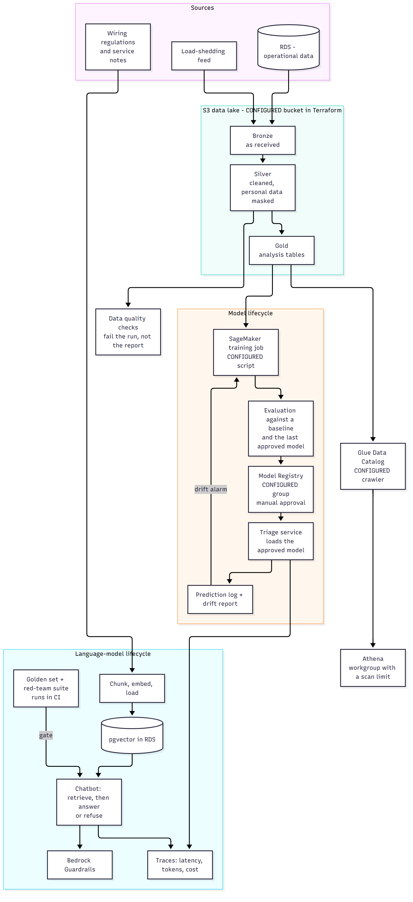
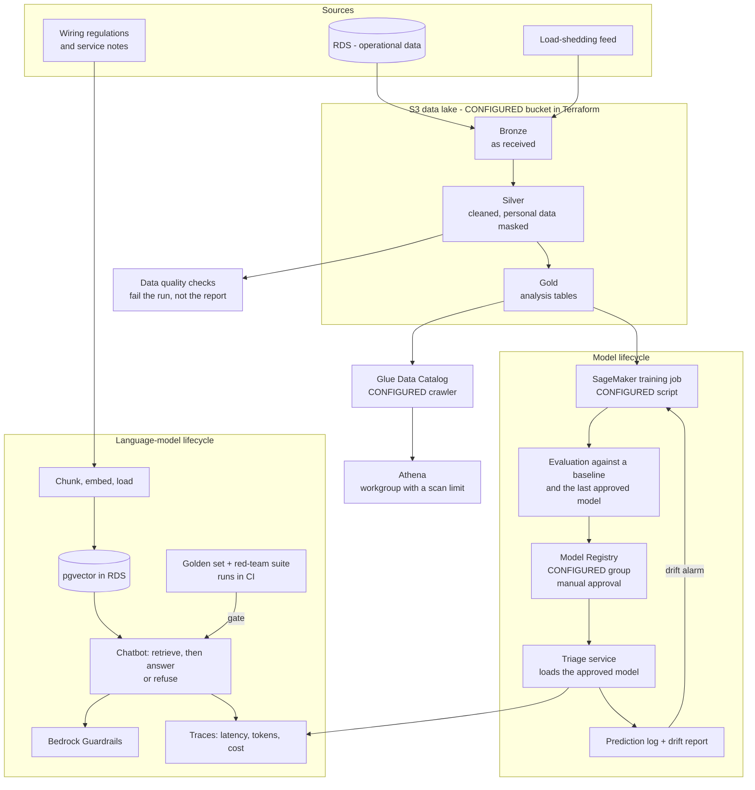
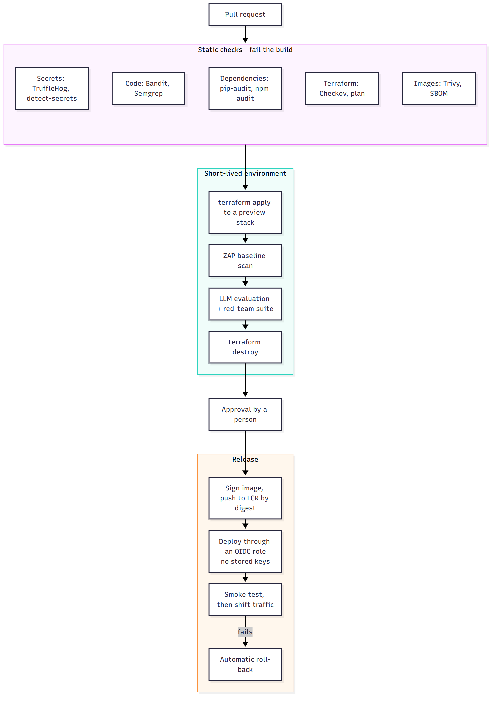
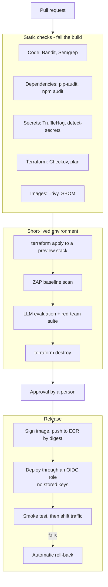

# Target state — AWS only

Written 9 October 2026. **Everything in this file is PLANNED unless it says otherwise.**
Pieces already written in `terraform/aws/` are marked *CONFIGURED*: they are code, not
running resources. Nothing has been provisioned.

**Platform: AWS, region `af-south-1`.** One cloud for every Rams @Elec project. Under that
rule the non-AWS pieces in the code today — Groq, Vercel, Twilio, n8n, Airflow on a
container — each get an AWS replacement, and [why.md](why.md) says what each swap costs.

**How to read this document.** It has two tiers, and they are kept apart on purpose:

| Tier | What it is | Who it is for |
|---|---|---|
| **Core** | The smallest design that runs this platform safely for one small business | The client |
| **Practice track** | Controls a senior engineer is expected to design, operate and explain, each one small enough to switch on, learn from, and switch off | The author's growth, at a few dollars |

A component is in Core only if this client needs it. Everything else is honest practice,
labelled as such, and is never described as something the client required.

## 1. Runtime and security

Diagram source (Mermaid) - edit this, then run <code>render-diagrams.sh</code>

## 2. Data, machine learning and language models

Diagram source (Mermaid) - edit this, then run <code>render-diagrams.sh</code>

## 3. Delivery pipeline

Diagram source (Mermaid) - edit this, then run <code>render-diagrams.sh</code>

## 4. Core design

### Network layout

- **Edge:** Route 53, CloudFront with an ACM certificate, and AWS WAF. The site has a
  public enquiry form and a chatbot that costs money per call, so a rate limit at the edge
  is Core here, not practice.
- **One VPC, two availability zones.** Private subnets hold the database and the functions
  that use it. Nothing in them has a public address.
- **Outbound through one small NAT instance.** A NAT gateway would cost more than the
  database. Free gateway endpoints carry S3 traffic.
- **Security groups by role**, least privilege: functions may reach the database port; the
  database accepts nothing else. Network ACLs stay at their defaults, and are stated as
  such rather than left unexplained.
- **VPC Flow Logs** to the log archive, sampled rejects only at first.

### Identity and roles

| Identity | Who or what | Can do | Cannot do |
|---|---|---|---|
| **Admin** permission set | Engineer, on purpose, with MFA | Change infrastructure | Be used without MFA; last beyond a one-hour session |
| **ReadOnly** permission set | Engineer day to day; the owner | Read state, logs, costs, findings | Change anything; read secrets or data |
| **Deploy** role (GitHub OIDC) | The release job on `main` only | Push one registry; update named functions; apply reviewed plans | Touch IAM, KMS key policies, or the audit services |
| **Break-glass** (management-account root) | Nobody, normally | Everything | Be used silently: hardware MFA with the owner, alarm on sign-in |
| **Function roles**, one per service | Each Lambda | Its own secrets, queue and tables | Anything belonging to another service |
| **Website: administrator group** | Staff | Admin section, analytics | — , MFA enforced |
| **Website: customer** | Customers | Own equipment, history, compliance | Other customers' records |

Guardrail policies at the organisation level deny, for every account: leaving the
organisation, using regions outside the approved list, switching off CloudTrail, GuardDuty
or Config, and creating access keys for root.

The business has a second system, a private job-management app in its own repository. It
would join this organisation as a second workload account, so these policies are written
once for both.

### Secrets and keys

- **Secrets Manager** for the database credential, with rotation; **Parameter Store** for
  configuration (two parameters are already *CONFIGURED* in `terraform/aws/`).
- **Customer-managed KMS keys, one per data class**: operational database, data lake,
  logs. Key policies name the roles that may use each; rotation is on.
- **No shared API key between the frontend and the services.** Calls are signed with the
  caller's own role and checked by API Gateway.
- **No long-lived AWS keys**, for people, for the pipeline or for the functions.

### Logging and audit

| What | Where | Kept |
|---|---|---|
| Account activity, plus reads and writes of buckets holding personal data | CloudTrail to the log archive bucket, object lock on | 1 year |
| Function and API logs, structured, with a request id | CloudWatch Logs | 30 days |
| Network rejects | VPC Flow Logs to S3, queried with Athena | 90 days |
| Sign-ins and administrative changes in the website | An audit table in the database (the security logger exists: `security/`) | With the data |
| Findings | Security Hub, forwarded by EventBridge to SNS | 90 days |

### Backups and recovery

- **Targets:** lose at most 5 minutes of data (point-in-time recovery); be running again
  within 4 hours by rebuilding from Terraform and restoring.
- **RDS automated backups, 7 days**, plus an **AWS Backup plan** with a locked vault so a
  backup cannot be deleted before its retention ends.
- **The data lake is versioned**, and its Gold layer can be rebuilt from Bronze.
- **Strategy: backup and restore.** A warm standby is not justified at this size.
- **A restore drill twice a year**, timed against the targets, with the result written down.

### Cost guardrails

- **The budget in the Terraform is 8 US dollars a month (`terraform/aws/variables.tf:60`). This target does not
  fit in it.** Core is roughly **40 to 70 US dollars a month** — an estimate from published
  prices, dominated by the database, the firewall and the NAT instance. The budget must be
  raised deliberately, by the owner, before anything is applied.
- Alerts at 50, 80 and 100 percent, and Cost Anomaly Detection.
- **Hard limits where a bill can run away:** an Athena workgroup scan limit, reserved
  concurrency on every function, a monthly token budget with an alarm for Bedrock, log
  retention on every log group, and the SageMaker endpoint kept off (it is already gated
  in `terraform/aws/sagemaker.tf`).
- **Every billable resource depends on the budget existing** — the pattern is already in
  the Terraform and stays.

## 5. Skill lanes — what a senior engineer is expected to design and explain

Each row names the control, where it sits, and the standard to meet. **Tier** is Core,
Practice (switch on, learn, switch off) or Scale (described only).

### Cloud security — mapped to the eleven C|CSE modules

| C\|CSE module | Control in this design | AWS services | Tier | You should be able to explain |
|---|---|---|---|---|
| 1. Introduction | Shared-responsibility table for this workload: who patches, encrypts, logs and backs up each layer | — | Core | Why "the provider encrypts it" does not answer who holds the key |
| 2. Platform and infrastructure | Private subnets, role-based security groups, guardrail policies, no public database | VPC, security groups, Network ACLs, Organizations, VPC Flow Logs | Core | Why a NAT instance here and a NAT gateway at scale; what a guardrail policy can and cannot stop |
| | Central inspection of outbound traffic | Network Firewall | Scale | When domain filtering justifies its cost |
| 3. Application security | Edge rate limit and managed rules; signed service calls; input limits; least-privilege function roles | WAF, API Gateway, Cognito, IAM, Inspector | Core | Why each of the 17 frontend API routes needs its own check, not only the page layouts |
| 4. Data security | Classification, a key per class, masking in the Silver layer, discovery of stray personal data | KMS, Macie, S3 object lock, RDS encryption | Core; Macie is Practice | Envelope encryption; key policy versus IAM policy; what Macie finds and what it costs per gigabyte |
| 5. Security operations | One place for findings, a baseline benchmark, drift detection, patching of the one instance | Security Hub, Config, GuardDuty, CloudWatch, Systems Manager, Trusted Advisor | Core; Config rules are Practice | Why Config is the expensive one, and which few rules earn their cost |
| 6. Penetration testing | A scan of the preview stack on every release; a cloud configuration review; AWS's testing policy | ZAP, Prowler, IAM Access Analyzer | Practice | What you may test without asking AWS, and what you may not |
| 7. Incident response | A written runbook per finding type; alert to phone; contain with approval: revoke sessions, quarantine, disable a key | EventBridge, SNS, Lambda, Systems Manager | Core runbook; automation is Practice | The order: contain, preserve, eradicate, recover — and why preserving comes before fixing |
| 8. Forensics | Evidence that cannot be altered; snapshot and isolate; queries over the trail and flow logs | CloudTrail, S3 object lock, EBS snapshots, Athena | Practice | Chain of custody in a cloud account; why you snapshot before you terminate |
| | Linking findings across services automatically | Detective | Scale | — |
| 9. Continuity and recovery | Stated targets, point-in-time recovery, locked backups, timed restore drill | RDS, AWS Backup, S3 versioning, Glacier | Core | The four recovery strategies and why backup-and-restore is right at this size |
| | Continuous replication to a second region | Elastic Disaster Recovery | Scale | Cross-border transfer of personal data under POPIA |
| 10. Governance, risk, compliance | A risk register; controls mapped to POPIA and to CIS; evidence collected from the tools above | Security Hub standards, Config, Artifact | Core register; Audit Manager is Scale | The difference between a control, its evidence, and an audit finding |
| 11. Standards, policies, legal | Data-residency decision; retention periods; breach-notification steps; operator agreement with the provider | Organizations region policy, Artifact | Core | What POPIA requires within what time after a breach, and who the operator is |

### Data and cloud security engineering

| Control | Standard to meet | Tier |
|---|---|---|
| Data map: every personal field, its table, its bucket, its key, who may read it | Kept in the repository and checked in CI against the schema | Core |
| Personal data never leaves the Silver layer unmasked | A test fails the pipeline if a masked column appears in Gold | Core |
| Column-level permissions on analysis tables | Lake Formation grants, not bucket policies | Practice |
| Retention and deletion | Lifecycle rules and a deletion job that proves a customer's records are gone | Core |
| Data quality | Schema, null-rate and range checks that fail the run, with the failure counted | Core |
| Lineage | Each Gold table records the Bronze objects and the code version it came from | Practice |

### DevSecOps

| Control | Standard to meet | Tier |
|---|---|---|
| Scanning in the pipeline | Already *WIRED*: seven scanners in `.github/workflows/security.yml`. Add Terraform scanning and make every scan blocking | Core |
| Supply chain | Actions pinned by commit, images by digest, a bill of materials per build, signed images | Core; signing is Practice |
| Infrastructure as code | Remote state with locking; plan on every pull request; apply only after a person approves | Core |
| Policy as code | A handful of written rules — no public buckets, no unencrypted storage, tags required — enforced on the plan | Practice |
| Short-lived environments | A preview stack per release, scanned and destroyed | Practice |
| Deploys | Keyless, by digest, with a smoke test and automatic roll-back | Core |
| Drift | A scheduled plan that alerts when reality differs from the code | Practice |

### AI and machine-learning engineering

| Control | Standard to meet | Tier |
|---|---|---|
| One provider behind one interface | Bedrock, called through a single module with timeouts, retries and a fallback answer | Core |
| Guardrails | Prompt-attack filter, personal-data masking and refused topics, applied to input and output | Core |
| Evaluation before release | A golden set per task — triage classification, retrieval answers — scored in CI; a release cannot lower the score | Core |
| Red-team suite | Prompt injection, data exfiltration and jailbreak cases mapped to the OWASP LLM Top 10 and MITRE ATLAS, run on the preview stack | Practice |
| Retrieval that can say no | An answer cites the passages it used, and refuses below a similarity floor | Core |
| Tracing | Every call records latency, tokens, cost and the prompt version | Core |
| Agents kept on a lead | The three-agent crew has no write tools; a person confirms any dispatch | Core |
| Model supply chain | The approved model's hash is recorded and checked at load | Practice |
| Data residency | If the chosen model is not offered in `af-south-1`, the call leaves the region: decide and write it down before use | Core |

### Data science

| Control | Standard to meet | Tier |
|---|---|---|
| Real data before real claims | The estimator is trained on synthetic data today (`services/triage/model/metrics.json`). No accuracy figure is quoted to anyone until it is retrained on real jobs | Core |
| A baseline | Every model is reported beside the simplest alternative — the mean, or last month's value | Core |
| Honest validation | A split by time, not at random; cross-validation reported with its spread | Core |
| Explanations | SHAP values per estimate (already *WIRED* in `services/triage/main.py`), checked for stability | Core |
| Experiment record | Every run's data version, code version, parameters and metrics | Core |
| Monitoring | Input drift and error on fresh labels, with a threshold that triggers retraining | Practice |
| A model card | Intended use, training data, limits and known failure cases, in the repository | Core |
| Champion and challenger | A new model takes a share of traffic before it replaces the old one | Scale |

## 6. What would change at larger scale

- **Several businesses on one platform:** separate accounts per environment and per tenant,
  a dedicated log-archive account, and a NAT gateway per zone.
- **Regulated or audited data:** Audit Manager, Detective, Network Firewall and
  customer-managed keys in a hardware module.
- **Real traffic:** a multi-zone database with a standby, provisioned concurrency, and a
  managed vector store if retrieval outgrows the database.
- **A model that matters commercially:** a hosted inference endpoint, champion and
  challenger, and scheduled retraining pipelines.

## 7. What deliberately stays

- The six services' code and their input validation.
- The fail-closed API-key gate, until signed calls replace it.
- The budget-first Terraform pattern.
- The rule this repository is built on: nothing is claimed that cannot be verified.
